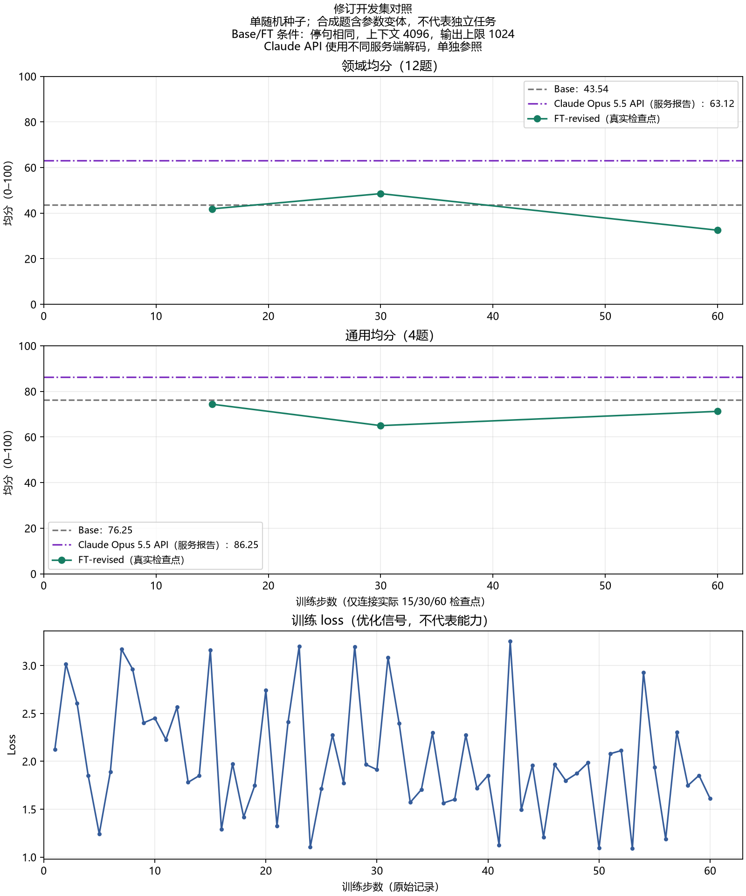

# 修订开发集对照

30 步版本的领域均分比基座高 5.00 分，但通用低 11.25 分；60 步领域反而下降。三个版本都没有同时达到既定门槛，当前不能宣称整体微调成功，也不推荐部署。

**SOURCE_FACT**：每组均完整回答同一 16 题、29 轮。Luna 去身份草评，主 Agent 逐轮读原回答并复核；题目、评分要点和回答保持原样。

| 模型/检查点 | 领域均分（12题） | 通用均分（4题） | 领域硬错题数 |
| --- | ---: | ---: | ---: |
| Base | 43.54 | 76.25 | 10/12 |
| 第二轮，15 步 | 41.88 | 74.38 | 12/12 |
| 第二轮，30 步 | 48.54 | 65.00 | 10/12 |
| 第二轮，60 步 | 32.50 | 71.25 | 12/12 |
| Claude Opus 5.5 API 参照 | 63.125 | 86.25 | 8/12 |

硬错题数是至少含一条明确硬错误的题目数，不能与错误条数互换；各组通用题均无硬错。适用维度按 0–2 分，再归一化到 100；只有分数至少 80、每项至少 1 且无硬错的题目才计通过。通过数和错误条数保留在[聚合 CSV](图表/修订开发曲线.csv)。

**DERIVED**：候选要求通用至少 71.25（Base 减 5），领域硬错题不超过 10。15、60 步的硬错题超限，30 步的通用分不足。按事先固定的规则，领域最高的 30 步只进入最终 50 题的诊断对照；不是合格部署候选。最终诊断现已完成，FT-revised step 30 相对 Base 的领域均分提高 3.5625 分，但通用均分降低 5.75 分且领域硬错题增加 2 题，不能据此称整体成功。完整结果见[最终诊断对照](最终诊断对照.md)；不在当前终测集上继续调参。

Base 与 FT 均为 4-bit、关闭 thinking、greedy、context 4096、输出上限 1024、seed 3407，使用相同的 `qwen35-chat-stop-v1` 停句规则，并各自维护历史。触及输出上限的回答按实际内容评分，没有删掉失败项或延长单个模型的输出。这是本轮比较设置，不是模型原生上下文的上限。

Claude 参照只接收学生材料和自己的历史，不看教师答案、评分或工具；使用同一已配置 API 服务的独立请求。服务报告名称为 `claude-opus-5-5`，未经独立身份认证。服务默认解码、输出上限 8192，与本地条件不同，图中单独作为参照，不作同条件胜负判断。

第二轮训练数据共 90 条：原 30 条教师改写与主 Agent 审校样本，加 48 条本地数值推导、12 条自编通用对话，见[修订训练记录](修订数据与训练记录.md)。它是混合数据，不能描述为纯教师或纯开源数据。数据、学习率等一并调整，不能单独归因哪一项起效；训练 loss 只记录优化过程，不代表能力。

本轮只有一个随机种子，题目是自编合成场景、包含同任务族参数变体，不是官方 Benchmark，也不能证明实际器件、生产力、长上下文、隐私隔离或成本目标已通过验收。早期停句不完整的数字见[旧诊断记录](首轮开发集对照.md)，不混入本图。

图表另提供 [PNG](图表/修订开发曲线.png) 和 [SVG](图表/修订开发曲线.svg)。
