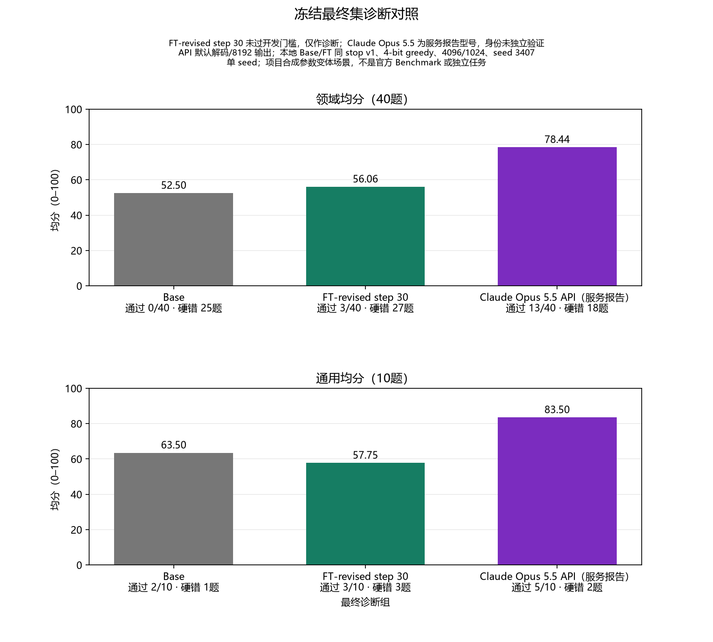

# 最终诊断对照

## 结果

**SOURCE_FACT**：冻结的最终集包含 40 道领域题和 10 道通用题。Base、FT-revised step 30 与 Claude 服务报告组各完成 50 题、73 轮推理。题目和评分标准没有改动；分组匿名草评后，由主 Agent 逐轮复核。下表中的“硬错”先按题统计，括号内为错误条数。

| 对照组 | 领域均分 | 领域通过 | 领域硬错题 | 通用均分 | 通用通过 | 通用硬错题 |
| --- | ---: | ---: | ---: | ---: | ---: | ---: |
| Base | 52.50 | 0/40 | 25（25条） | 63.50 | 2/10 | 1（1条） |
| FT-revised step 30 | 56.06 | 3/40 | 27（29条） | 57.75 | 3/10 | 3（3条） |
| Claude（服务报告型号） | 78.44 | 13/40 | 18（20条） | 83.50 | 5/10 | 2（2条） |

适用维度按 0–2 分归一化到 100；通过要求至少 80 分、各项至少 1 分且没有硬错，见[评测规则](评测规则.md)。

**DERIVED**：FT-revised step 30 相对 Base 的领域均分提高 3.5625 分，通用均分降低 5.75 分；领域硬错题从 25 题增至 27 题。领域分数的局部提高没有抵消通用表现下降和硬错增加。

FT-revised step 30 在开发集上没有达到既定门槛。它是在读取最终题目和答案前按预先规则选出用于诊断的版本，不是部署候选。本结果不支持推荐部署，也不能称为整体微调成功。Claude 组型号仅为服务报告，未经独立身份验证；其默认解码和 8192 输出上限与本地 Base/FT 的 4-bit greedy、4096 context、1024 输出上限不同，因此不据此作同条件胜负判断。

Base 与 FT 均关闭 thinking、seed 3407，使用同一 `qwen35-chat-stop-v1` 停句规则；每个模型只使用自己的对话历史。Claude 也只看学生材料和自身历史，不看教师答案、评分或工具。

本轮只有一个随机种子。题目是项目自编的合成场景，同一任务族含参数变体，不是官方 Benchmark，也不能证明真实器件、生产或部署能力已通过验收。达到输出上限的回答按实际内容评分；Base 为 39/73，FT 为 15/73，这只是本轮的截断计数，不能当作速度或耗时保证。

第二轮训练数据共 90 条，是混合来源：14 条 Stack Exchange 领域材料经教师改写及主 Agent 实质校正，48 条本地数值推导，另有 16 条首轮自编对话和 12 条自编通用对话；不能描述为 90 条全由教师提供。数据与学习率等一并调整，结果不能单独归因于某一因素。

如需继续评估，下一轮必须建立全新的独立终测集。当前 final50 的题目、评分标准和回答不得用于训练或回训，也不得据此调参后再将结果称为独立终测。

图表数据：[CSV](图表/最终诊断对照.csv)、[PNG](图表/最终诊断对照.png)、[SVG](图表/最终诊断对照.svg)。
