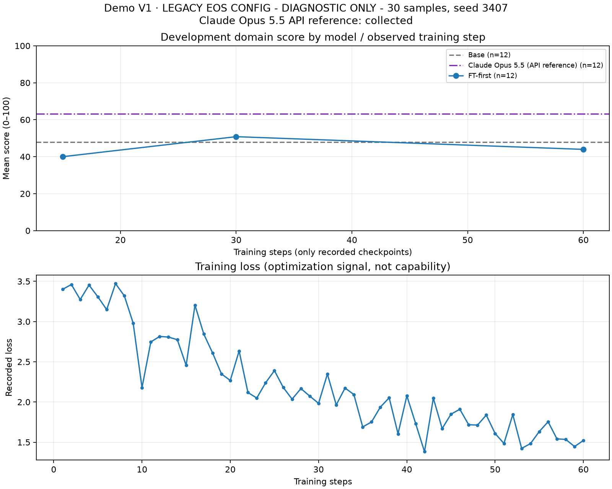

# 首轮开发集对照

**诊断记录，暂不作为效果结论。** 后续运行时核查确认本地停句名单漏了聊天回合结束标记。以下输出与数字保留，但不能沿用来判断微调增益、退步或选择检查点；基座与微调模型将统一新规则重算。见[修复说明](停句配置修复说明.md)。独立 API 参照未受本地问题影响。

本轮观察 16 道自编合成开发题：领域 12 道、通用 4 道，包含同任务族的参数变体。Luna 去身份草评后，由主 Agent 逐题复核；题目和模型回答保持原样。单 seed、小样本的结果不是官方 Benchmark，也不是生产验收。

| 检查点 | 领域（n=12） | 通用（n=4） |
| --- | ---: | ---: |
| Base | 47.92 | 76.25 |
| FT-first，step 15 | 40.00 | 65.63 |
| FT-first，step 30 | 50.83 | 65.63 |
| FT-first，step 60 | 43.96 | 69.38 |
| Claude API 参照 | 63.13 | 86.25 |

按旧运行口径，step 30 的领域数字高约 2.92 分，通用低约 10.63 分。这些变化不能在停句缺陷排除前归因于微调，也不能用于正式选型。

本地 Base 与 FT 使用相同的 4-bit、关闭 thinking、greedy 解码、4096 context 和 1024 max-new 配置。Claude API 参照也回答同一 16 题，只收学生材料与自己的历史，不收教师答案、评分要点或工具。服务报告模型名 `claude-opus-5-5`，身份未经独立认证；服务默认解码、max output 8192，与本地条件不同，因此单独标注。

| 输出 metadata（每组 16 题合计） | 输出 tokens | 时延（秒） | 截断题数 |
| --- | ---: | ---: | ---: |
| Base | 25,082 | 1,178.2573 | 11/16 |
| FT-first，step 15 | 8,186 | 535.0171 | 3/16 |
| FT-first，step 30 | 3,985 | 253.7850 | 1/16 |
| FT-first，step 60 | 2,989 | 191.1313 | 0/16 |
| Claude API 参照 | 13,857 | 744.9880 | 0/16 |

时延为逐轮生成时间之和。本地 token 数由 Qwen tokenizer 统计，Claude token 数是服务报告值，不视为相同计量口径。更短、更快不代表更正确，以上未折算生产成本。图中 loss 只表示训练优化信号。

本轮训练使用 30 条样本（seed 3407），共 4,341 个监督 tokens，并重复训练。停句缺陷和小样本都可能影响旧表现，当前数据不能证明各自因果。第二轮已完成 90 条混合数据、学习率 2e-5 的训练，见[修订记录](修订数据与训练记录.md)；待统一新协议重算后再报告效果。

图表提供 [PNG](图表/首轮开发曲线.png)、[SVG](图表/首轮开发曲线.svg) 和[聚合 CSV](图表/首轮开发曲线.csv)。
